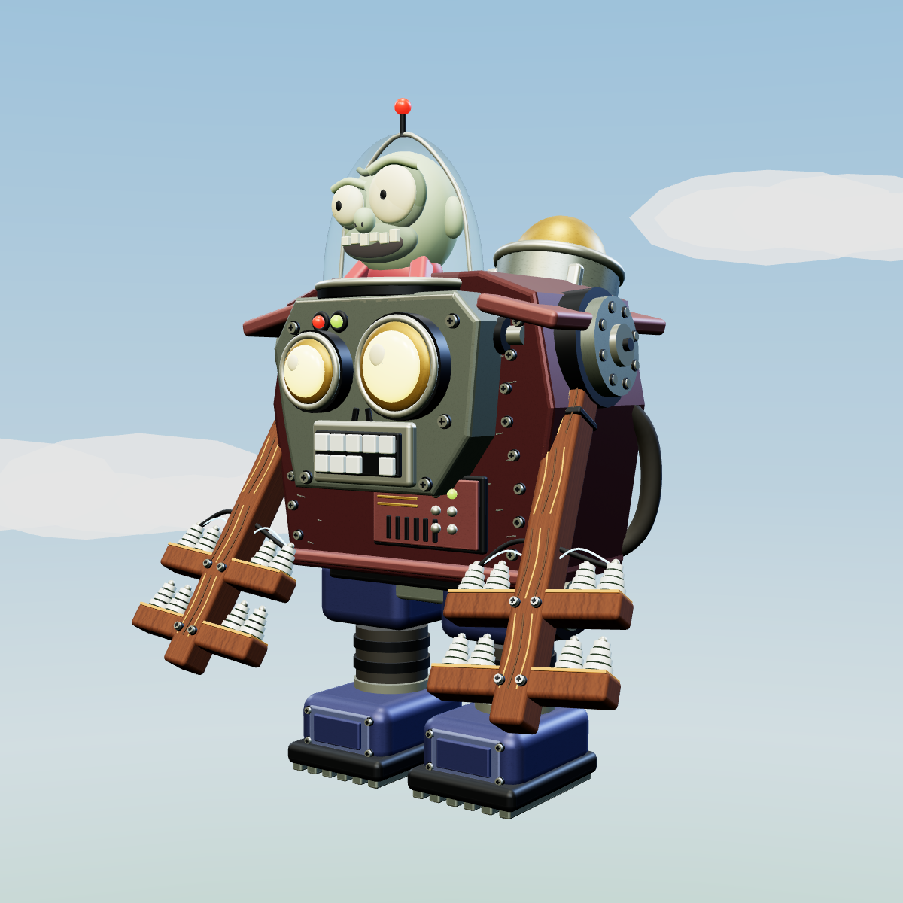

# Mecha Gargantuar — wave 10

The final wave's existing `finalBoss` pack now spawns Mecha Gargantuar. Press **V** during play to spawn one immediately. The boss bar names the current attack and reminds players to aim for the head during recovery.

## Reference and fidelity

The supplied image defines the art direction: burgundy armored housing, asymmetric robot face with luminous yellow eyes, visible Imp pilot under glass, rear gold bomb vessel, blue boots and exposed bellows, and two wooden telephone poles with ceramic insulators. The complete model is procedural geometry with locally generated enamel and timber textures. No external model, texture, or audio assets are required.

The [Mech Gargantuar reference](https://plantsvszombies.wiki.gg/wiki/Mech_Gargantuar) describes Robo-Smash, rocket-assisted Robo Charge Smash, three electric Pulse Shots, and a Time Bomb with a four-second fuse and roughly 30 damage. It also describes body armor and an unarmored head. These attack identities inform this implementation. The screenshot resembles the Gargantuar Prime design; it is intentionally the visual authority here while GW2 supplies the combat kit.

This is a researched adaptation, not recovered original game code. Movement speed, cooldowns, armor factors, ranges, collision rules, recovery windows, and telegraphs are tuned for Garden Defense. There are no invented invulnerability phases or Zombie King reinforcement phases in the new boss behavior.

## Art and animation

- Beveled asymmetric plates, shoulder hubs, cross-head screws, access panels, ventilation slots, pressure gauge, hoses, pistons, chipped paint, and wood grain.
- Cockpit canopy, rim and antenna; sculpted pilot with unequal eyes, brow, nose, grin, uneven teeth, jacket, hands and control sticks.
- Separate shoulder and leg joints, weighted alternating steps, torso sway, pilot counter-motion, raised pole anticipation, impact crouch, firing recoil, mortar tilt, and visible rocket exhaust.
- Material-batched geometry within each joint; per-instance materials and resources; explicit disposal on death or reset.
- Electrical impacts, drifting damage smoke, bomb fuse lights and ground warning, positional synthesized audio, and distance-scaled camera shake.

## Combat contract

`CONFIG.MECHA` holds combat tuning. The roster entry has 3200 HP. Ordinary body hits receive a 0.35 multiplier; heavy attacks receive 0.7. Direct upper-head/cockpit hits bypass body armor and preserve each weapon's own critical-hit multiplier.

The shared targeting/flow-field system supplies movement goals. The dedicated `mechaBehavior` owns walk, charge windup, charge, smash, strike, pulse, bomb and recovery states. The charge locks its direction before moving, checks terrain/props/battlements, and never tracks a dodging plant. Pulse shots sweep their path to prevent tunneling on slow frames. Smash and bomb damage use three-dimensional distance and sight checks. The boss can damage the garden while the squad is down.

Bombs use ballistic motion, collision substeps, bounce, and a four-second fuse from launch. They remain dangerous after their owner dies, but match reset removes them and their warnings. Stuns suspend the boss's attack state through the shared zombie pipeline.

## Verification

Run `node tests/mecha-gargantuar.cjs` with Playwright installed (or `NODE_PATH` pointing to the bundled desktop modules). `PLAYWRIGHT_CHROMIUM_EXECUTABLE` optionally selects a browser executable.

The test renders front, three-quarter and rear previews, then checks natural use of all four attacks, exact burst count, armor/head/heavy damage, fuse timing and damage, wave 10 scheduling, dodgeable charges, wall collision, pulse cover, high ground, garden damage, independent rigs, death disposal and reset cleanup. Other plant/agent regression suites cover the shared projectile path.

